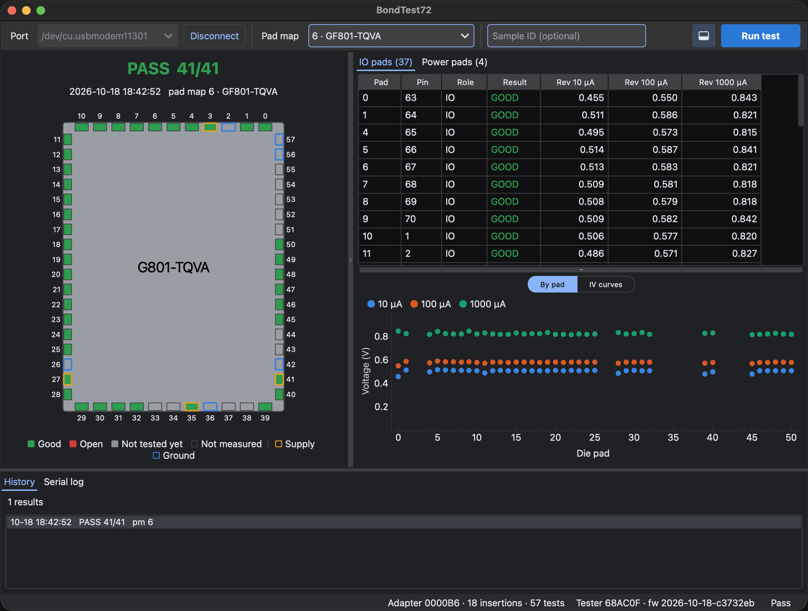

# BondTest72 GUI

Desktop app for the BondTest72 wirebond tester: choose the pad map, run tests,
and view and record per-pad results.



Work in progress.

## Requirements

- [uv](https://docs.astral.sh/uv/getting-started/installation/). It sets up
  everything else on the first run: a Python 3.11+ if the machine has none,
  and the pinned packages (about 150 MB, mostly Qt).

**Linux:** Qt needs a few system libraries that minimal installs can lack,
most often `libxcb-cursor0` (`sudo apt install libxcb-cursor0` on
Debian/Ubuntu). To open the tester's serial port without root, add yourself to
the `dialout` group (`uucp` on Arch): `sudo usermod -aG dialout $USER`, then
log out and back in.

## Running

```sh
cd gui
uv run gui
```

(`uv run bondtest72-gui` and `uv run python -m bondtest72_gui` work too.)

## Using it

- **Connecting.** The app connects to the tester automatically when exactly
  one is plugged in; otherwise pick the port and press Connect.
- **Pad map.** Choose the adapter's pad map in the toolbar. Changing it clears
  the result on screen and redraws the die for the new map. With no tester or
  adapter, the die for pad map 2 (1x1) is shown. A choice lasts until the
  adapter is unplugged or the tester restarts; Set as default stores the
  current map in the adapter EEPROM so it is selected every time that adapter
  is detected. The dropdown marks the adapter's default.
- **Running a test.** Run test (Ctrl+R) starts a test. The optional sample ID
  is stored with the result.
- **Die view.** Pads are filled by result and outlined by role; the legend
  under the die names the colours. Click a pad to select it in the table and
  graph.
- **Tables and graphs.** IO pads and power pads each get a tab: a sortable
  table with a graph underneath. IO pads have two graphs, voltage by pad and
  every pad's IV curve; power pads show charging curves. Scroll over an axis to
  zoom it, drag an axis to pan it, and use the "A" button in the graph's
  corner to restore the view.
- **History and serial log.** The bottom panel lists this session's results
  and the raw serial traffic. The toolbar button left of Run test (or View →
  History and serial log, Ctrl+J) hides it to make room.
- **Recording.** Live results are appended to a daily JSONL file in the
  results folder (File → Results folder; default `results/` under the folder
  the app was started from). File → Record results turns this off. The file
  format is described in [`docs/RESULTS_JSONL.md`](../docs/RESULTS_JSONL.md).
- **Earlier results.** File → Open results file (Ctrl+O) loads a results file,
  including the factory tool's, into the history. Tester → Show last result
  (Ctrl+L) fetches the tester's last result; Esc returns to the live view.

The app follows the system's light or dark setting.

## Code

The core is kept free of Qt so it can be used from scripts and tests:

| Module | Purpose |
|--------|---------|
| `protocol.py` | Parse tester lines and build commands (`docs/BONDTEST72_HOST_PROTOCOL.md`) |
| `assembler.py` | Collect a test's protocol lines into one result |
| `session.py` | Track tester state (adapter, pad maps, state) and the queries that keep it fresh |
| `models.py` | Result data model, shared by live results and results files |
| `results_jsonl.py` | Read and write results files (JSON Lines, one test per line) |
| `die_shapes.py` | Die outlines and pad rings for drawing results |
| `tester_serial.py` | Find the tester's serial port and read lines in the background |
| `formatting.py` | Text for measurements (Ω, V, µA, ms) |

The Qt user interface:

| Module | Purpose |
|--------|---------|
| `app.py` | Entry point; sets the app icon (`icon.svg`) |
| `theme.py` | Flat light/dark theme (qdarktheme) following the system setting |
| `main_window.py` | Main window: connection, pad map, run, results history, serial log |
| `connection.py` | Moves serial lines onto the Qt event loop and feeds the session |
| `die_view.py` | Die drawing with pads coloured by result, and its colour legend |
| `results_panel.py` | One pad group's results: sortable table with its graph underneath |
| `pad_table.py` | Per-pad table, one column per voltage reading |
| `charts.py` | IO pad voltages and IV curves, power pad charging curves (pyqtgraph) |

## Development

```sh
cd gui
uv run pytest
```

Dependencies are pinned to exact versions in `pyproject.toml`, including the
indirect ones, and `uv.lock` records their hashes. To upgrade, edit the
versions, run `uv lock`, and review what changed before committing.
